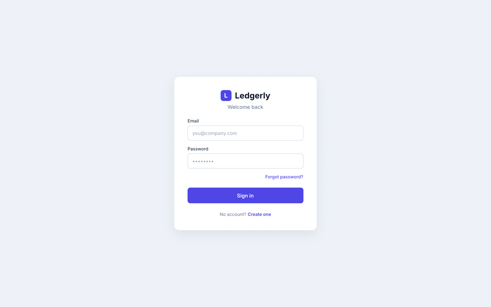
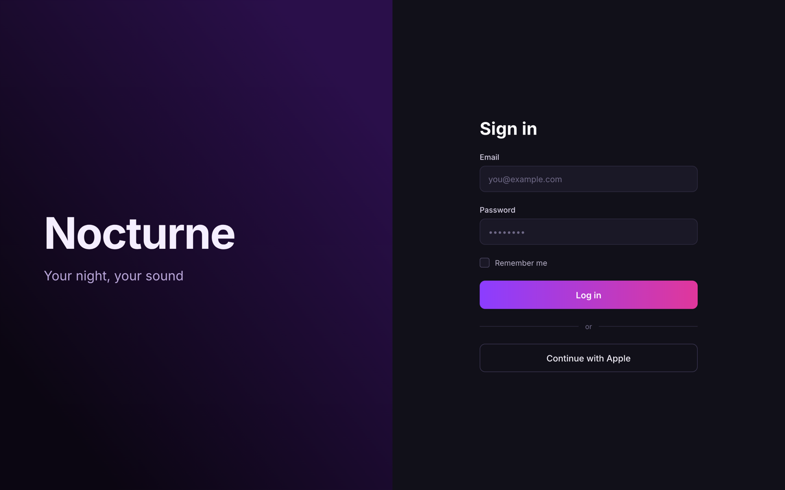

# Pencil

<p align="center">
  
  
</p>
<p align="center"><em>Two login screens designed at the same time by two Claude Code sessions, each in its own Pencil document, then saved and exported with this plugin.</em></p>

A Claude Code plugin that opens `.pen` design documents in the real Pencil editor, without adding another chat interface. A local Node.js service keeps one channel per design session, so several agents can work on the same document at the same time.

This repository, **pencil-claude**, contains one independently installable Claude Code plugin. Its display name is **Pencil** and its identifier is `pencil`. The Codex version lives in the separate [pencil-codex](https://github.com/julien-m/pencil-codex) repository.

## How the editor is shown

Claude Code does not render MCP Apps: according to the [MCP Apps documentation](https://claude.com/docs/connectors/building/mcp-apps/quickstart), it calls the tool as text and does not display the UI. An embedded panel inside Claude Code is therefore **not available**.

Instead, the plugin's local service serves the editor page itself. `pencil_open` returns a `viewUrl` on `127.0.0.1`. Opening it loads the real hosted Pencil editor (`https://app.pen.dev`) and connects it to the session channel:

- **Claude Code in the Claude desktop app:** the agent opens `viewUrl` in the desktop app's built-in Browser pane. This is the setup validated below. It is a local browser view, not a native panel.
- **Claude Code in a terminal:** open `viewUrl` in any browser on the same machine.

The plugin also declares an MCP Apps resource (`ui://pencil/editor-v1.html`) for hosts that render MCP Apps. This path has **not** been validated with Claude. Claude Desktop chat and claude.ai ignore local (stdio) MCP servers from plugins, so this plugin's tools are not available there.

## Requirements

- Claude Code with plugin support.
- Node.js 22 or later on `PATH`.
- Network access to the hosted Pencil editor at `https://app.pen.dev`.
- A browser on the same machine (or the Claude desktop app's Browser pane).
- Bun for development and tests only.

The plugin does not redistribute the proprietary Pencil engine and does not work offline.

## Installation

```bash
claude plugin marketplace add julien-m/pencil-claude
claude plugin install pencil@pencil
```

Inside an interactive session you can use `/plugin marketplace add julien-m/pencil-claude`, then `/plugin install pencil@pencil`. Start a new session afterwards so the tools load.

The built bundles are committed, so installation needs neither a compiler nor `node_modules`. Tools appear as `mcp__plugin_pencil_pencil__pencil_*`, and the bundled `pencil` skill describes the workflow to the agent.

To update or remove:

```bash
claude plugin marketplace update pencil
claude plugin update pencil@pencil
claude plugin uninstall pencil@pencil
```

## Usage

Ask Claude to use Pencil, for example: “Open /absolute/path/landing.pen in Pencil and add a pricing section.”

1. The agent calls `pencil_open` with an absolute `.pen` path and an explicit `scope`, or `pencil_new` to create a document. It receives a `sessionId` and a `viewUrl`.
2. The agent (or you) opens `viewUrl`. **Keep the view visible**: a page loaded or left in a hidden pane or background tab may never start the Pencil engine, and calls then time out.
3. The agent waits until `pencil_status` reports `connected: true`, then loads the native instructions with `pencil_call` → `read_skill`.
4. Each read/edit/verify sequence is wrapped in `pencil_begin` → `pencil_call` → `pencil_end`.
5. To collaborate, other agents receive the `sessionId` only and join with `pencil_begin`. They must not open the same file under another `scope` (that is refused with `DOCUMENT_BUSY`).

### Shared sessions

Exclusivity is held by the **design session**: a document belongs to one session at a time. Inside it, access is **not exclusive**: every agent that calls `pencil_begin` gets its own access token, and all of them work on the document at once.

- Calls are sent to the engine immediately, without a session-wide queue. Each request carries its own correlation id, so responses can arrive in any order and still reach the right agent.
- Because writes are no longer taken in turns, agents should split the work (for example one screen or one frame each), re-read before editing, and never modify nodes they did not create.
- `pencil_end` gives back an agent's token; it is refused only while that agent still has calls in flight.
- `pencil_save` and `pencil_save_as` wait only for the operations already in flight when they are called, then for the engine's autosave of their result (up to 5 s). New calls are not blocked meanwhile.

Documents open only through `pencil_open` or `pencil_new`. The plugin does not register any `.pen` file association.

### Tools

| Tool | Purpose |
|---|---|
| `pencil_open` | Open an existing `.pen` file in a design session; returns `sessionId` and `viewUrl` |
| `pencil_new` | Create a `.pen` file at a new absolute path (never overwrites), then open it |
| `pencil_status` | Connection, agents currently in the session with their calls in flight, save state, draft path |
| `pencil_tools` | Native engine tool schemas |
| `pencil_begin` / `pencil_end` | Join / leave the shared session; each agent gets its own non-exclusive access token |
| `pencil_call` | Call native tools: `execute`, `get_app_state`, `get_style`, `read_skill`. Pass `readOnly: true` for `execute` snippets that only read |
| `pencil_capture` | PNG captures of node IDs, or `["document"]` for the whole design |
| `pencil_export` | PNG, JPEG, WEBP, PDF, HTML/CSS or HTML/Tailwind export of the selected nodes |
| `pencil_save` | Replace the original `.pen` file with the last acknowledged draft; refused if the file changed on disk since it was loaded |
| `pencil_save_as` | Copy the last acknowledged draft to a new `.pen` file |

Captures, exports, Save and Save As need an access token. Captures, exports and Save As need an existing absolute destination and never overwrite an existing file; Save is the only tool that replaces a file, and only the session's own original. Exporting HTML/CSS and HTML/Tailwind both write `index.html`, so use separate directories for them. Engine screenshots are small previews; use `pencil_export` for full-resolution images.

### Agent activity

The local view shows a badge listing every agent in the session, marking those with calls in flight (for example “● Sub-agent 1 (working) · Sub-agent 2 (working) — 2 agents on this document”), updated over the session channel. The label is chosen by the agent and is not an authenticated identity. The plugin does not create per-agent cursors or presence on the Pencil canvas.

The page contains the unmodified Pencil editor: layers, components, zoom, Sign In, Goodies and settings stay as Pencil provides them. The plugin adds a two-line header above the editor and never hides or alters Pencil's interface with CSS, DOM injection or overlays.

## Architecture

```
Claude Code session ──stdio──▶ MCP server (dist/server.mjs, one per session)
                                   │ authenticated HTTP RPC on 127.0.0.1
                                   ▼
                     Local service (dist/daemon.mjs, one per user)
                       • sessions, access tokens, drafts
                       • GET /view/<sessionId>/<grant>  → editor page
                       • WebSocket /editor              → session channel
                                   ▲
Browser view (127.0.0.1) ──────────┘   iframe: https://app.pen.dev/new?embed
                                       (MessageChannel bridge to the engine)
```

- The first MCP server to start spawns the detached local service; later sessions reuse it, which is how agents in different Claude Code sessions share a design session. If the service restarts, MCP servers reconnect automatically on the next call (sessions are then reopened with `pencil_open`).
- Native tool calls require an access token and are forwarded at once; responses are matched by request id.
- The engine reads and writes the document through the channel; the service never decodes `.pen` contents.

Source: [MCP server](src/server.mjs), [client/service bootstrap](src/client.mjs), [local service](src/broker.mjs), [sessions and storage](src/sessions.mjs), [file outputs](src/artifacts.mjs), [editor view](web/editor.mjs).

## Storage

- Private data lives in `${CLAUDE_PLUGIN_DATA}` (by default `~/.claude/plugins/data/pencil-pencil/`), which survives plugin updates and is removed when the plugin is uninstalled from its last scope unless you keep its data. If the variable is absent (development), `PENCIL_DATA` or the plugin's `.runtime/` directory is used.
- `connection.json` holds the service port, its private token and PID (mode 0600).
- The engine's autosaves go to `drafts/<hash>.pen`, keyed by scope and file. The original document changes only when an agent calls `pencil_save`. Reopening the same file with the same `scope` reloads the draft, including after a service restart.
- `pencil_save` requires `saveState` `draft-saved`. It checks that the original still has the content the engine loaded (otherwise `SAVE_CONFLICT`, and nothing is replaced), copies the previous version to `backups/`, then atomically replaces the file, keeping its permissions. A final check runs just before the replacement; a write by another program in that last instant can still be lost, which is why the backup exists.
- `pencil_save_as` copies the draft to a new file once `saveState` is `draft-saved`. Any `execute` call not marked `readOnly` sets `saveState` to `check-required` until the engine saves again; an edit that changes nothing does not trigger a save.
- Assets are limited to `images/` and `fonts/` next to the document. Traversal paths, symbolic links and `.pen` files used as assets are rejected.

## Security

- The service listens on `127.0.0.1` only. RPC requires a random bearer token; each editor view gets a separate random grant restricted to its session, and only one view can be attached to a session at a time.
- `viewUrl` contains that grant. Anyone on the machine who has the URL can open the session view, so do not share or publish it. The view page is served with `Referrer-Policy: no-referrer`, `Cache-Control: no-store` and a nonce-based Content Security Policy that only allows frames from `https://app.pen.dev` and a WebSocket to the local service.
- No API key is bundled; tokens are generated at runtime. Documents stay local, but their contents are processed by the hosted Pencil editor. Review pen.dev's terms before using sensitive documents.
- Access tokens identify agents; they lock nothing, neither between agents nor against manual edits in the editor. Split the work between agents and do not run automated edits while someone edits by hand.

## Verified behavior and limits

Verified on macOS with Claude Code 2.1.296, the plugin installed from a local checkout of this repository with `claude plugin install`, and the view opened in the Claude desktop app's Browser pane:

- A design session survived a restart of the local service: reopening the same file with the same scope reloaded both agents' work from the draft; `pencil_save_as` then wrote a new file (a second Save As to the same path was refused) and the original was unchanged.
- Two Claude Code sessions, each with the installed plugin, created two documents and designed the two login screens shown above at the same time; each view showed its own agent badge, and each draft contained only its own design. `pencil_save` then wrote both designs into their original files and kept backups of the previous versions.
- Captures of a component, a screen and the whole document; exports in all six formats; document creation; Save; Save As; layers panel navigation.

Known limits:

- No embedded panel in Claude Code (see above); the MCP Apps resource is untested with Claude.
- The view must stay visible while agents work. An unanswered call times out after 15 s with `OUTCOME_UNKNOWN` and blocks the session. Never replay that mutation: reload the view, which reloads the last saved draft and unblocks the session (`recoveries` increases); then re-read before editing.
- Asynchronous generation (`Generate(...)`) is not supported.
- External `.pen` libraries and the editor's document-library requests (such as `documents-list`) are not implemented; open and create documents with the plugin tools.
- Two views of different documents can be open at once. A view that was loaded while visible kept working from a background tab during the test; a view first loaded in a hidden pane did not start the engine.

## Stopping the service

The service survives the end of a Claude Code session. To stop it, read `pid` from `connection.json` in the data directory and send `SIGTERM`. Drafts are kept. After an interrupted start, a stale `starting` directory there can be removed once no service is running.

## Development

```bash
git clone https://github.com/julien-m/pencil-claude.git
cd pencil-claude
bun install --frozen-lockfile
bun run build
bun run test
bun run test:protocol
claude plugin validate . --strict
```

`bun run build` regenerates `dist/server.mjs`, `dist/daemon.mjs`, `dist/editor.html` and `THIRD-PARTY-NOTICES.md`; commit them with source changes. Unit tests use Bun; the loopback transport and MCP stdio tests use Node.js, like the installed runtime. Keep the version in `src/version.mjs`, `package.json` and both manifests in sync (a test checks it); bump it when the service protocol changes so a running older service is replaced.

To install from a local checkout:

```bash
claude plugin marketplace add "$PWD"
claude plugin install pencil@pencil
```

To try a disposable document in a standalone development service:

```bash
bun run preview /absolute/path/to/example.pen
```

Open the printed `viewUrl`. This harness runs its own private service, separate from the installed plugin's; its output contains local credentials, so do not publish it.

## License

MIT — see [LICENSE](LICENSE). Third-party licenses for bundled libraries are in [THIRD-PARTY-NOTICES.md](THIRD-PARTY-NOTICES.md). This is an independent integration, not affiliated with or endorsed by Pencil or Anthropic. The hosted Pencil engine remains subject to its publisher's terms. See also the [upstream embed proposal](https://github.com/highagency/pen-embed-demo).
